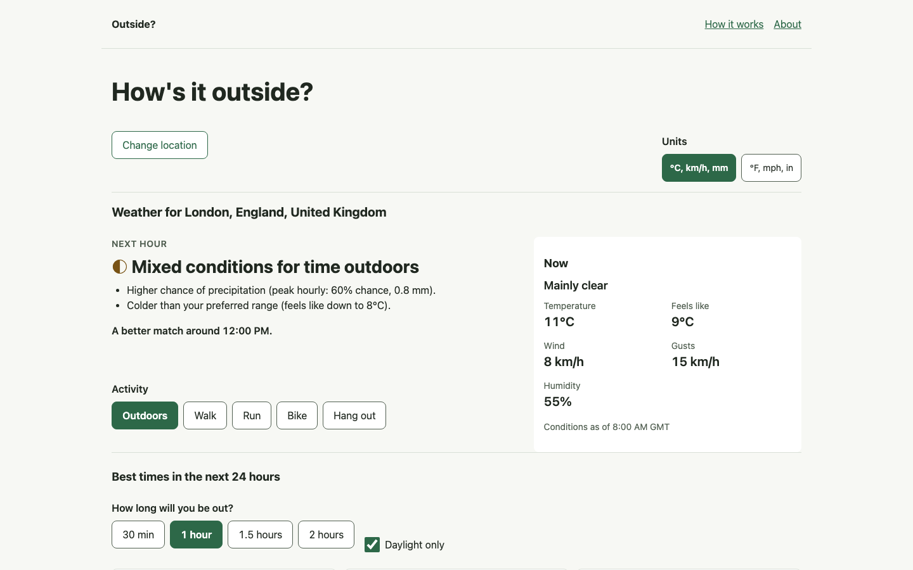

# Outside?

**Should you head outside now, or is there a better time in the next 24 hours?** Outside? turns the forecast into a clear, explained match for walking, running, cycling, hanging out or just being outdoors.



<sub>Screenshots use synthetic sample weather from the test fixtures, not a real forecast.</sub>

- **Live site:** pending launch (planned: https://outside.knnaresh.com)
- **Source:** this repository (public URL to be confirmed before launch)

No account, no install and no tracking analytics. Location permission is optional: you can always search for a city. Matches are based on **your preferences and the forecast shown**. They are not safety advice and don't include air quality, UV or official alerts.

## What it does

- Choose a place by city search or a one-time "Use my location" (rounded to about 1 km).
- Pick an activity: Outdoors, Walk, Run, Bike or Hang out. Switching is instant and doesn't refetch weather.
- See the next hour as Good match, Mixed conditions, Poor match, Limited data or Check conditions, with up to two reasons.
- Get up to three best windows for 30, 60, 90 or 120 minutes, with daylight-only on by default.
- Browse the next 24 hours in the place's own time zone, including daylight-saving changes.
- Adjust comfortable feels-like range and rain and wind tolerance per activity. Settings stay in your browser; your location is saved only if you opt in.
- Thunderstorms, freezing precipitation, strong gusts, heavy precipitation, extreme feels-like temperatures and snow or ice are always flagged and never suggested.

How it decides: [Methodology](src/pages/methodology.astro) (served at `/methodology/`). What it sends and stores: [Privacy](src/pages/privacy.astro) (`/privacy/`).

## Quick start

Requirements: Node 26 (`.nvmrc`) and npm. No API key or secret.

```sh
npm ci
npm run dev          # http://localhost:4321
```

Production build and local preview:

```sh
npm run build        # static site in dist/, with generated dist/_headers
npm run preview      # http://localhost:4321 (astro preview does not apply _headers)
```

## Scripts

| Command | What it does |
|---|---|
| `npm run dev` | Development server |
| `npm run build` | Astro static build, then CSP hashes into `dist/_headers`, then a guard against test markers in the bundle |
| `npm run preview` | Serve the production build on port 4321 |
| `npm run check` | Astro and TypeScript checks |
| `npm run lint` | ESLint (TypeScript, Astro, React hooks, JSX accessibility, domain purity rules) |
| `npm run test` | Vitest unit and integration tests (no watch) |
| `npm run test:e2e` | Playwright against the built site on port 4791, with headers applied. Run `npx playwright install chromium` once first |
| `npm run field-check` | Manual live check of Open-Meteo field availability; writes `docs/FIELD-AVAILABILITY.md`. Never runs in CI |

`E2E_ALL_BROWSERS=1 npm run test:e2e` adds Firefox and WebKit. `SCREENSHOT_DIR=/some/dir npx playwright test screenshots` captures review screenshots.

## Configuration

Public build-time values only (see `.env.example`). Everything here ships to the browser.

| Variable | Purpose |
|---|---|
| `PUBLIC_SITE_URL` | Canonical origin, e.g. `https://outside.knnaresh.com`. Required on Cloudflare Pages builds; defaults to localhost locally |
| `PUBLIC_SOURCE_URL` | Repository link; the Source link stays hidden until set |
| `PUBLIC_AUTHOR_URL` | Author link in the footer and About page |
| `PUBLIC_NOINDEX` | `true` for preview builds: adds `noindex` meta and `X-Robots-Tag` |

Set these as real environment variables in your host's build settings (the Astro config reads `process.env`). Provider endpoints are fixed in `src/lib/config.ts` and can't be overridden at runtime.

## Architecture

```text
Astro static pages ──► one React island (src/features/outside/OutsideApp.tsx)
                         │
                         ├─ controller: reducer + hook (selection, requests, cache, refresh)
                         ├─ services: Open-Meteo forecast and geocoding, cache, settings, geolocation
                         └─ domain (pure): normalization, scoring, flags, windows, explanations
```

- **Static output** on any HTTPS host; no server, database or secrets.
- **Browser → Open-Meteo directly.** The provider sees the visitor's IP and the rounded coordinates.
- **Pure, tested domain.** Internal units are SI and UTC epoch seconds. Precipitation, its probability and gusts are aligned to the hour they describe, which differs from instantaneous fields. Missing values stay `null`.
- **Strict CSP** generated at build time from the actual inline scripts, delivered by `dist/_headers`.
- **Budgets:** initial JS 94.9 KB of 100 KB gzip; CSS 2.7 KB of 30 KB (measured at M4).

Full design: [docs/02-ARCHITECTURE.md](docs/02-ARCHITECTURE.md), [docs/03-DATA-AND-API.md](docs/03-DATA-AND-API.md), [docs/04-SCORING.md](docs/04-SCORING.md). Implementation decisions: [docs/10-DECISIONS-SOURCES.md](docs/10-DECISIONS-SOURCES.md).

## Deploying your own copy

1. Build command `npm run build`, output directory `dist`, Node 26.
2. Set `PUBLIC_SITE_URL` (and `PUBLIC_NOINDEX=true` for preview environments).
3. Use a host that serves the generated `dist/_headers` (Cloudflare Pages does), or translate it to your host's header configuration. The CSP must be a response header, not a `<meta>` tag.
4. Check that your use of Open-Meteo's free hosted API is non-commercial and within its limits. Commercial or high-traffic deployments need a paid plan **and** a server-side proxy so the key never reaches the browser (see [docs/02-ARCHITECTURE.md](docs/02-ARCHITECTURE.md) §8).

The full runbook for outside.knnaresh.com is in [docs/08-DEPLOYMENT.md](docs/08-DEPLOYMENT.md).

## Known limitations

- Hourly forecasts: a 30-minute outing uses the whole hour's forecast, and dawn and dusk hours are excluded from daylight-only suggestions.
- No air quality, UV, pollen, official alerts, maps, routes, terrain or water conditions.
- Thresholds are product defaults, not validated comfort or health limits.
- Device location is approximate and labeled "Current area". There is no reverse geocoding.
- Times use US-style formatting in every language; translation is future work.
- Automated accessibility checks (axe) pass with zero violations. Manual screen-reader and real-device testing is still pending.
- E2E runs in Chromium by default; see [docs/ACCEPTANCE-RESULTS.md](docs/ACCEPTANCE-RESULTS.md) for other browsers.

## Contributing and security

See [CONTRIBUTING.md](CONTRIBUTING.md) and [SECURITY.md](SECURITY.md). Please don't post real coordinates or addresses in issues.

## License and data

Code: [MIT](LICENSE) © 2026 Naresh Kumar. Weather data by [Open-Meteo](https://open-meteo.com/) (CC BY 4.0). Location data by [GeoNames](https://www.geonames.org/) via Open-Meteo (CC BY 4.0). The MIT license does not cover the data or grant use of any hosted API; see [THIRD_PARTY_NOTICES.md](THIRD_PARTY_NOTICES.md).

The original specification pack starts at [docs/00-HANDOFF.md](docs/00-HANDOFF.md).
