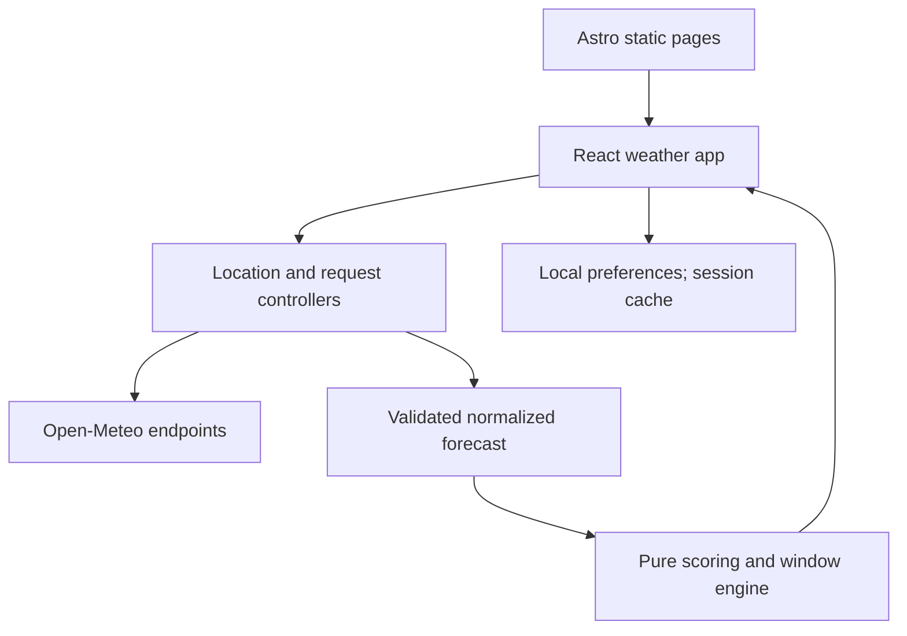

# 02 — Architecture

## 1. Baseline and rationale
Astro statically renders the page shell and supporting pages. One React island owns the entire interactive weather experience, avoiding synchronization between multiple hydrated roots. TypeScript domain modules normalize forecasts, calculate matches and windows, format time, and generate explanations. CSS custom properties carry a small shared design system. Do not add Tailwind, a component suite, state framework, date framework or chart framework by default.

The browser calls public weather and geocoding endpoints directly. This keeps a fork useful without infrastructure or keys and avoids a central coordinate database. The tradeoff is that the provider sees visitor IP and requested approximate coordinates; the app cannot centrally enforce a quota or hide a paid key. Use the documented proxy path if deployment needs either.



## 2. Responsibilities
- Presentation: semantic components, focus, display formatting. No raw provider JSON or independent formulas.
- Controller: state transitions, selected location, aborts, cache lifecycle, refresh triggers.
- Provider adapter: URL construction, timeout/retry, response validation, mapping to normalized domain types.
- Domain: activity presets, penalties, flags, time-window aggregation, ranked reasons; synchronous and deterministic.
- Storage adapter: versioned serialization and migration, exceptions caught, memory fallback.
- Configuration: deployment URL, source URL, provider endpoints, author link, build metadata. Public values only.

## 3. Suggested repository layout
```text
src/
  pages/ index.astro about.astro methodology.astro privacy.astro 404.astro
  layouts/ BaseLayout.astro
  components/ Header.astro Footer.astro
  features/outside/
    OutsideApp.tsx
    components/ LocationPicker.tsx ActivityPicker.tsx ConditionsSummary.tsx
                HourlyTimeline.tsx HourDetails.tsx WindowSuggestions.tsx
                PreferencesPanel.tsx DataStatus.tsx
    controller/ reducer.ts useWeatherController.ts
  domain/
    types.ts activities.ts score.ts flags.ts windows.ts explanations.ts
  services/
    weather/provider.ts weather/openMeteo.ts weather/normalize.ts
    geocoding.ts fetchJson.ts cache.ts storage.ts
  lib/ time.ts units.ts config.ts
  styles/ tokens.css global.css outside.css
public/ favicon.svg robots.txt _headers
 tests/ unit/ integration/ e2e/ fixtures/
docs/ [this specification and implemented runbooks]
.github/workflows/ci.yml
```
Paths are a guide; preserve domain boundaries if simplifying. Do not create a file per trivial function.

## 4. State model
LocationState = none | locating | selected | denied | unavailable. SearchState = idle | searching | results | empty | error. ForecastState = idle | loading | ready | refreshing | stale | error. `refreshing` carries the previous forecast and keeps displaying it, including its recommendations, unless that forecast has itself reached the stale tier; a refresh in progress must never blank or flicker the suggestions. Keep selected location and each forecast's location key together. An old forecast must never be displayed under a newly selected place.

Use discriminated unions with explicit data and error fields. On location change: increment generation ID, abort outstanding weather request, clear recommendations, resolve the new cache key and fetch if necessary. Accept a response only if its generation ID and location key match current selection. Aborted requests do not become user errors.

## 5. Loading and refresh
Initial geolocation timeout: 10 seconds, enableHighAccuracy false, maximumAge 300000. Forecast request timeout: 10 seconds. Search request timeout: 8 seconds. One automatic retry for network/5xx, with jitter around 750 ms. No automatic retries for invalid input or denial. For 429 honor Retry-After when parseable; otherwise use 60 seconds, disable retry until expiry, and never create a polling storm.

Refresh on explicit action, first selection, and visibility returning once the forecast is in the due tier or later. While visible, check age at most once a minute; at 15 minutes request refresh, never while offline or within cooldown. No background requests while hidden. Dedupe identical inflight requests. Activity/units/preferences changes do not request new weather.

## 6. Caching
Weather sessionStorage cache, key = provider+schema version+rounded lat/lon+canonical variable list+request units+time options. Request units are always the fixed SI request parameters; display units are never part of the key, so switching °C/°F or km/h/mph never misses the cache or refetches. Keep at most five entries, LRU evict. Fetch time is distinct from forecast timestamp. Reject a cache entry whose fetchedAt is more than 60 seconds in the future or whose schema, location key, or validated payload does not match.

Freshness tiers by age = now − fetchedAt (boundaries belong to the later tier):
| Tier | Age | Behavior |
|---|---|---|
| fresh | < 15 min | Display with recommendations; no refetch. |
| due | 15 min – < 60 min | Display with recommendations; attempt refetch per §5. If refetch fails, keep showing, add a quiet “Retrieved at [time]” note. |
| stale | 60 min – < 2 h | Display visibly stale; recommendations disabled; keep retrying per §5. |
| expired | ≥ 2 h | Clear the forecast display and show error. |

Rationale: a forecast retrieved 16 minutes ago is still a good forecast; pausing suggestions that early (for example when briefly offline) would be needlessly unhelpful. The 15-minute value controls refetch cadence only. Always recompute time selection using injected current time; a fresh cache can still run out of forecast horizon.

Geocoding memory cache: normalized query+language, TTL 24 hours, max 50 entries. Do not persist search history. Preferences localStorage v1; saved location only with remember opt-in. Storage failure degrades to memory, not an application crash.

## 7. Framework and dependency policy
Choose current mutually compatible stable Astro, React integration and React, strict TypeScript, Vitest, Playwright, and a small runtime schema validator such as Zod. Pin via package-lock.json and package engines. Select an actively supported Node LTS compatible with installed Astro; record exact version in .nvmrc and CI. No numeric framework version is mandated by this planning document.

Static output needs no Cloudflare SSR adapter. If paid proxy/SSR is introduced, recheck current Astro adapter targets: current and old documentation differ on Pages versus Workers. Do not copy an old SSR configuration into a current release.

## 8. Optional production proxy migration
Introduce WeatherProvider behind the same normalized contract. Client requests a same-origin /api/forecast with finite, rounded and bounded coordinates; worker accepts only predefined variables/horizon and fixed upstream hosts. Secret resides in worker secret storage. Add global budget monitoring, edge rate limiting, cache, timeout, response validation and redacted logging. Add tests against open relay/SSRF, arbitrary upstream URLs, oversized horizons and quota exhaustion. Configure geocoding consistently if using paid endpoints. Use current supported Cloudflare Workers deployment; this is an explicit architectural change, not part of static free-mode MVP.

## 9. Failure isolation
Search failure must not erase existing weather. Current conditions failure may coexist with valid hourly data. Hourly failure means no ranked windows even if current data exists. Storage unavailable must not disable search. Missing icons use text fallback. JavaScript disabled shows a clear explanation and useful About/Privacy links. Host failure and provider failure are distinct runbook cases.
