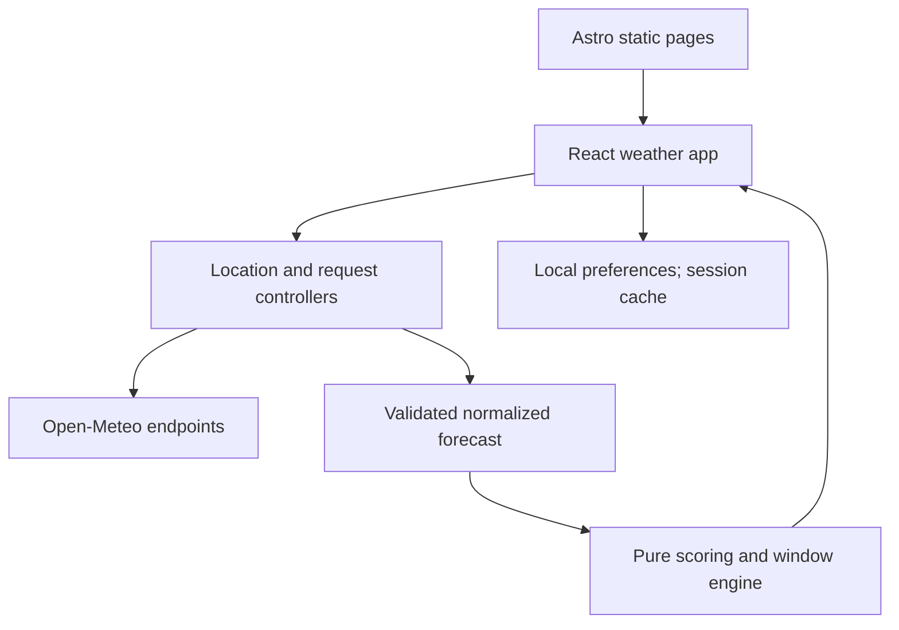

# Outside? — Complete agent specification

11 November 2026 · Version 1.1

**Revision 1.1 (11 November 2026):** worst-factor score cap and updated golden examples (SCORING §3, §8, §9); freshness tiers and non-flickering refresh (ARCHITECTURE §4–§6, SCORING §4); cache key excludes display units; 2-character search with Enter submit; multi-region field-availability check in M0; single-Tab-stop timeline; CSP delivery mechanics; Playwright clock harness; matching tests, M0 exit criteria and ADR-015–021; open product calls listed in DECISIONS.

This single-file edition contains the full 16-document handoff. For repository-ready individual files, use the accompanying ZIP. Relative file references below describe paths within that ZIP.

---

**Repository file: `README.md`**

# Outside? — implementation handoff

Version 1.1 · 11 November 2026 · Owner: Naresh Kumar

**A public, open-source outdoor weather decision tool at https://outside.knnaresh.com.**

This pack is a proposed build specification, not an implemented application. PRB means Product Requirements Brief here; the PRB also serves as the detailed PRD. Product decisions below are recommended defaults unless explicitly identified as confirmed. No repository, domain, deployment, or provider account has been inspected or changed.

## Confirmed intent

- A general outdoors tool, not a running-only product.
- Visitors can open the site and get conditions for their own location.
- Open-source code that others can use, adapt, and deploy.
- A separate subdomain of Naresh's existing Astro portfolio: outside.knnaresh.com.
- A detailed handoff suitable for a coding agent.

## Recommended implementation baseline

Astro static output, TypeScript strict mode, one React interactive island, plain CSS design tokens, direct browser requests to Open-Meteo, no database, no account, no AI runtime, no API secret. Cloudflare Pages static hosting is the initial deployment target. Keep the existing portfolio independent. The code license is MIT; weather and location data retain their own licenses.

An open-source license does not grant commercial use of a third-party hosted API. Because this project sits under a professional portfolio domain, do not assume the free API's noncommercial eligibility. Resolve that before public launch; local development and the rest of the implementation can proceed. A paid deployment requires a server-side proxy; never ship a provider secret to the browser.

## Read in this order

1. [Agent start prompt](START_HERE.md)
2. [Product requirements](docs/01-PRB.md)
3. [Architecture](docs/02-ARCHITECTURE.md)
4. [Data contracts and integrations](docs/03-DATA-AND-API.md)
5. [Scoring and recommendations](docs/04-SCORING.md)
6. [Interaction and visual design](DESIGN.md)
7. [Privacy and security](docs/05-PRIVACY-SECURITY.md)
8. [Testing and acceptance](docs/06-TEST-PLAN.md)
9. [Implementation plan](docs/07-IMPLEMENTATION-PLAN.md)
10. [Deployment and operations](docs/08-DEPLOYMENT.md)
11. [Open-source readiness](docs/09-OPEN-SOURCE.md)
12. [Decisions and source references](docs/10-DECISIONS-SOURCES.md)

[PRODUCT.md](PRODUCT.md), [AGENTS.md](AGENTS.md), and [WORKFLOW.md](WORKFLOW.md) are repository-ready guidance. Copy this pack into the new repository, preserving the paths.

## Authority and change control

User instructions override this pack. PRB owns scope; SCORING owns formulas; DATA-AND-API owns normalized data semantics; DESIGN owns UI behavior; TEST-PLAN owns acceptance evidence. If a contradiction remains, record and resolve it before implementing dependent behavior. Do not silently substitute a complex stack or invent external integrations.

## What is deliberately not shipped in this pack

No application source, production secrets, live API test results, legal opinion, medically validated thresholds, or claim that a real deployment has been verified. All weather examples are illustrative. The implementation agent must generate and test the actual code.

---

**Repository file: `START_HERE.md`**

# Paste this prompt into the implementation agent

Build **Outside?**, an open-source outdoor weather decision app, from the attached specification pack. Read README.md, PRODUCT.md, AGENTS.md, WORKFLOW.md, DESIGN.md, and every numbered document in docs/ before changing application code.

Use a separate Astro project intended for outside.knnaresh.com. Do not modify the existing knnaresh.com portfolio. Inspect the working repository and its instructions before scaffolding. If the repository is empty, scaffold there. If it contains unrelated work, create a sibling project or isolated worktree without overwriting it.

Implement the MVP completely: location permission and city search; General Outdoors, Walk, Run, Bike and Hang out; current conditions; hourly timeline; activity preferences; best duration-based windows; deterministic explanations; stale and partial data handling; responsive accessible UI; tests; CI; privacy and methodology pages; open-source documentation. Follow the exact data normalization and scoring contract. Scores are preference heuristics, not safety or clinical assessments.

Work in the milestones in docs/07-IMPLEMENTATION-PLAN.md. Begin with fixture-driven tests for normalization, DST, scoring, missing data, and window selection. Use a static Astro shell and one React island; no database, account system, AI API, map library, or secret in the browser. Do not create mock live weather or treat null as zero. Make routine implementation choices autonomously and record deviations in the decision log.

Install mutually compatible current stable dependencies and commit a lockfile. Verify documentation against installed versions rather than using unpinned latest versions throughout the project. Keep all domain calculations in SI units and display in the selected units. Use target-location IANA time zones, never the device zone for forecast labels.

Deliver working code, meaningful passing tests, responsive screenshots from desktop and mobile, accessibility results, build and bundle evidence, a deployment runbook, and a concise known-limitations list. Run local production preview, not just the dev server. A failing check must be disclosed, not bypassed or described as passing.

Complete local implementation and reviewable deployment configuration. Publishing to production, purchasing a service, or changing DNS requires deployment authorization from the owner. Do not block ordinary coding on deployment decisions. Before public launch resolve the Open-Meteo hosted API eligibility for this portfolio-linked site. If a commercial key is needed, use the documented proxy migration; never add it to PUBLIC_* or client code.

Start by reporting your repository findings and a short implementation checklist, then build. Ask only about genuinely blocking missing information, not routine preferences already covered by this pack.

---

**Repository file: `PRODUCT.md`**

# Outside? — product context

## Job
Help someone decide whether to head outside now, and identify a better upcoming window for walking, running, cycling, or spending time outdoors.

## Audience and scene
A worldwide public audience, frequently on a phone before leaving home. Someone may have little technical knowledge, deny location access, use a screen reader, or inspect a city in a different time zone. Developers are a secondary audience who want to fork the project.

## Product promise
Useful conditions in two interactions: select location, optionally select activity. Explain why a period matches preferences. Do not frame weather suitability as a universal safety verdict.

## Primary surface
Operate mode: an immediately useful weather tool. Compact light interface, clear typography, restrained color, generous touch targets. No marketing hero before the tool, stock photos, signup gate, or onboarding questionnaire.

## Scope
General Outdoors, Walk, Run, Bike, Hang out; now and 24-hour outlook; 30/60/90/120-minute windows; optional preferences; local settings; location search; accessibility; open-source deployment docs. Air quality, UV, official alerts, route planning, maps, accounts, and notifications are future work.

## Success
A first-time visitor can locate themselves or a city and understand the result without instructions. Switching activities is immediate and does not refetch weather. Missing data, stale forecasts, and concerning weather cannot be mistaken for good conditions.

## Ownership
Naresh Kumar. Proposed production URL: https://outside.knnaresh.com. Separate Astro repository. Defaults and tradeoffs are documented in docs/01-PRB.md and docs/10-DECISIONS-SOURCES.md.

---

**Repository file: `AGENTS.md`**

# Agent instructions

## Invariants
- Preserve unrelated work. Never overwrite the portfolio or an existing deployment.
- Implement the PRB scope, not speculative future features.
- Pure scoring/normalization/time modules must not import React, browser globals, or network code.
- No private location in page URLs, analytics, logs, or issue templates.
- No credentials in client bundles. Free mode has no credentials at all.
- Never coerce missing weather values to zero, falsy coordinates to missing, or UTC seconds to local ISO strings.
- Recommendations must be explainable from the same contributions used by the scoring engine.
- Raw provider data is untrusted input. Validate at the boundary.
- Mark product assumptions and heuristic thresholds explicitly.

## Commands the completed repository must expose
`npm run dev`, `npm run build`, `npm run preview`, `npm run check`, `npm run lint`, `npm run test`, `npm run test:e2e`.

`check` runs Astro and TypeScript checks. `test` is a non-watching unit/integration run. CI must not call a watching test command. Add scripts using the actual installed tools, not placeholder echo commands.

## Engineering style
Strict TypeScript; avoid any and non-null assertions at API boundaries. Use discriminated unions for asynchronous states. Small cohesive functions; explicit input time for deterministic logic. Prefer semantic HTML and platform APIs. Use a single validated configuration module. Avoid a global state library unless demonstrated necessary.

## Changes and evidence
Before changing scoring, add or update boundary tests and a methodology entry. Before changing storage, add migration/reset tests. Before changing request caching, test stale, abort, and retry cases. Update docs when behavior changes. Record version changes and reasons in CHANGELOG.md.

## Scope and completion
No deploy, paid subscription, or DNS mutation without owner authorization. Do not claim live smoke tests, accessibility conformance, or browser support beyond evidence actually collected. Explain blocked checks. Stop adding features when acceptance criteria pass.

---

**Repository file: `WORKFLOW.md`**

# Implementation workflow

1. Inspect repository status, instructions, installed dependencies, build scripts and hosting configuration. Save the clean baseline or document preexisting changes.
2. Translate PRB acceptance IDs into a short checklist in IMPLEMENTATION_STATUS.md. Record dates, completed work, test evidence and remaining risks.
3. Build small vertical slices. Write failing domain tests first; implement; run targeted tests; then integration checks at milestone completion.
4. Use deterministic fixture weather for development and automated tests. Live network calls belong only in explicit smoke tests and never gate ordinary unit CI.
5. Make coherent commits at passing milestones. Record a last-known-good commit after each milestone. Never use destructive reset to erase user changes.
6. Inspect the assembled interface at mobile and desktop sizes in one review pass; fix findings together; perform one confirmation pass. Functional failures still require correction.
7. Run the final checks once the final change is complete. Re-run affected checks if a subsequent fix changes behavior.
8. Produce a final report: what works, commands and results, deployment instructions, known limitations, and unresolved owner decisions.

## Long-session handoff
At approximately 45–50 tool calls, or before context becomes constrained, update IMPLEMENTATION_STATUS.md with current branch/commit, files changed, exact failing tests, next step, unresolved assumptions and local preview instructions. Continue from this checkpoint rather than repeating discovery. Delegation is optional only when explicitly authorized by the user or project instructions; this document does not request additional agents.

## Definition of done
All P0 acceptance criteria verified, no fabricated data, production build and preview working, privacy and attribution visible, README suitable for a first-time contributor, and production release checklist either passed or explicitly marked pending authorization.

---

**Repository file: `docs/01-PRB.md`**

# 01 — Product Requirements Brief / PRD

## 1. Purpose and positioning
Outside? answers two questions: “What is it like outside for what I want to do?” and “When is a better time in the next 24 hours?” It turns weather into an understandable preference match, while keeping the underlying forecast visible. It is not a route planner, warning service, medical advisor, or guaranteed real-time observation feed.

The website is the product. A visitor clicking its public link should see a functional tool, not repository instructions. GitHub is a secondary link for developers. No account, onboarding wizard, installation, payment, or personal profile is required.

## 2. Goals and non-goals
P0 goals: immediate location selection, clear current summary, comparable hourly outlook, activity-specific preferences, best continuous window, worldwide place search, honest limitations, mobile and keyboard usability, easy static self-hosting.

Non-goals for v1: maps, routes, direction-specific cycling wind, minute-by-minute rain predictions, official hazard coverage, AQI, UV, pollen, mountain or marine advice, event calendars, social feeds, push notifications, accounts, multiple saved places, monetization, AI-generated advice, native mobile apps, offline PWA behavior.

Do not describe excluded variables as checked. “Good match” is based on the displayed forecast dimensions, not air quality or official alerts. Swimming, climbing, boating and remote hiking need different data and must not be implied by the general label.

## 3. Personas and use cases
- Casual visitor: wants to walk for half an hour, accepts default preferences.
- Runner/cyclist: wants to compare heat, wind and precipitation across a longer outing.
- Parent or friend: wants a comfortable period to sit outdoors.
- Traveler: searches a remote city; needs that city's local time, not their laptop's time.
- Privacy-conscious visitor: denies location, manually searches, disables persistence.
- Developer: clones the repository, runs it without secrets, deploys independently.

## 4. MVP functional requirements

| ID | Priority | Requirement | Acceptance |
|---|---|---|---|
| LOC-01 | P0 | Explicit Use my location button | No location prompt before user action; denied/timeout/unavailable flows offer city search |
| LOC-02 | P0 | Global city search | Keyboard-selectable results include city, region and country; selection fetches correct coordinates |
| LOC-03 | P0 | Returning location | With remember enabled, restore a rounded location marked Saved location; never silently reacquire GPS |
| LOC-04 | P0 | Reset privacy controls | Forget location clears persisted location and forecast cache; stays usable in memory |
| WX-01 | P0 | Current conditions | Actual, apparent temperature, wind/gusts, condition text and data timestamps shown where available |
| WX-02 | P0 | Next 24 hours | Scrollable timeline plus readable detail, with local dates and timezone |
| WX-03 | P0 | Data integrity | Missing fields show unavailable; stale data is marked; critical missing data prevents recommendations |
| ACT-01 | P0 | Activity choice | Outdoors default plus Walk, Run, Bike, Hang out; changes rerank locally |
| PREF-01 | P0 | Preferences | Feels-like range, rain tolerance, wind tolerance, daylight-only, duration, units; reset per activity |
| WIN-01 | P0 | Best window | Up to three non-overlapping windows for chosen duration, ranked deterministically |
| WIN-02 | P0 | Honest empty results | No suitable/eligible window explains constraints rather than recommending poor or incomplete periods |
| EXP-01 | P0 | Explanations | Summary reasons derive from the scoring engine; no LLM required |
| ACC-01 | P0 | Accessible interaction | Full keyboard task completion, visible focus, semantic controls, live status, no color-only meanings |
| OSS-01 | P0 | Reusable source | MIT code license, setup, tests, deployment, data attribution and commercial API caveat |
| OPS-01 | P0 | Resilient requests | Debounce, cancellation, bounded retries, rate-limit feedback and cache |
| DOC-01 | P0 | Public supporting pages | About, methodology, privacy, and not-found pages |
| SHARE-01 | P1 | City-level sharing | Later; no GPS sharing by default and not needed for MVP |

## 5. First visit and return visit
First visit: app name, concise question, location button and search; no forecast until a place is selected. A clearly labeled example may appear in development only. Once selected, show skeletons and a single status message, then conditions. Activity defaults to Outdoors; duration 60 minutes. Preferences are optional.

Return visit: restore versioned preferences and, if explicitly enabled previously, saved rounded location; label saved rather than current. Fetch when cache is stale. Keep a visible Change location action and one-click location refresh. A saved location is not evidence the person is still there.

## 6. Preference behavior
Default units are Celsius/km/h/mm unless navigator locale explicitly includes US; en-US defaults to Fahrenheit/mph/in. Language alone does not establish country; fall back to metric. The visitor can override at any time. Switching units changes formatting only and cannot change the recommendation. Duration choices: 30, 60, 90, 120 minutes. Activity-specific settings persist separately; duration and units are global. Daylight-only defaults on for all activities and can be switched off without hiding concerning-weather notices.

Preference edits update results immediately. Forms use numeric controls with visible bounds, not sliders alone. Celsius comfort bounds -30 to 45, low strictly below high. Invalid edits retain last valid applied values and show inline errors. Tolerance enums: rain avoid/light/okay; wind low/medium/high. Rain tolerant never disables severe-weather flags.

## 7. Success measures and launch criteria
No analytics service in v1. Evaluate with scripted usability tasks and optional owner testing: a new visitor reaches conditions within two deliberate choices; activity switches respond under 100 ms on a representative midrange phone; search denial never traps the user; at least five representative international locations render correctly in manual smoke testing.

Performance targets: initial first-party JS <=100 KB gzip, CSS <=30 KB gzip; static initial page target LCP <=2.5 s, CLS <=0.1 in a documented mobile lab configuration. API latency is reported separately. These are budgets to measure, not promises already achieved.

## 8. Risks and mitigations
Provider availability/limits: cache, backoff, visible failure. Worldwide variability: missing-data handling. Misleading recommendation: heuristic labeling, separate flags, no safety language. Privacy: permission on action, rounding, opt-in persistence. Time zones: UTC arithmetic with IANA formatting and DST tests. Scope growth: defer maps/AQI/alerts. Commercial eligibility: release gate and proxy design.

## 9. Remaining owner decisions
Not blockers for coding: exact repository URL, public contact method, final display name, domain account configuration, and live API commercial eligibility. Default to Outside?, MIT, no analytics, light theme, and no monetization. Do not invent contact addresses or GitHub URLs; hide unconfigured links in previews and require them before public launch.

---

**Repository file: `docs/02-ARCHITECTURE.md`**

# 02 — Architecture

## 1. Baseline and rationale
Astro statically renders the page shell and supporting pages. One React island owns the entire interactive weather experience, avoiding synchronization between multiple hydrated roots. TypeScript domain modules normalize forecasts, calculate matches and windows, format time, and generate explanations. CSS custom properties carry a small shared design system. Do not add Tailwind, a component suite, state framework, date framework or chart framework by default.

The browser calls public weather and geocoding endpoints directly. This keeps a fork useful without infrastructure or keys and avoids a central coordinate database. The tradeoff is that the provider sees visitor IP and requested approximate coordinates; the app cannot centrally enforce a quota or hide a paid key. Use the documented proxy path if deployment needs either.



## 2. Responsibilities
- Presentation: semantic components, focus, display formatting. No raw provider JSON or independent formulas.
- Controller: state transitions, selected location, aborts, cache lifecycle, refresh triggers.
- Provider adapter: URL construction, timeout/retry, response validation, mapping to normalized domain types.
- Domain: activity presets, penalties, flags, time-window aggregation, ranked reasons; synchronous and deterministic.
- Storage adapter: versioned serialization and migration, exceptions caught, memory fallback.
- Configuration: deployment URL, source URL, provider endpoints, author link, build metadata. Public values only.

## 3. Suggested repository layout
```text
src/
  pages/ index.astro about.astro methodology.astro privacy.astro 404.astro
  layouts/ BaseLayout.astro
  components/ Header.astro Footer.astro
  features/outside/
    OutsideApp.tsx
    components/ LocationPicker.tsx ActivityPicker.tsx ConditionsSummary.tsx
                HourlyTimeline.tsx HourDetails.tsx WindowSuggestions.tsx
                PreferencesPanel.tsx DataStatus.tsx
    controller/ reducer.ts useWeatherController.ts
  domain/
    types.ts activities.ts score.ts flags.ts windows.ts explanations.ts
  services/
    weather/provider.ts weather/openMeteo.ts weather/normalize.ts
    geocoding.ts fetchJson.ts cache.ts storage.ts
  lib/ time.ts units.ts config.ts
  styles/ tokens.css global.css outside.css
public/ favicon.svg robots.txt _headers
 tests/ unit/ integration/ e2e/ fixtures/
docs/ [this specification and implemented runbooks]
.github/workflows/ci.yml
```
Paths are a guide; preserve domain boundaries if simplifying. Do not create a file per trivial function.

## 4. State model
LocationState = none | locating | selected | denied | unavailable. SearchState = idle | searching | results | empty | error. ForecastState = idle | loading | ready | refreshing | stale | error. `refreshing` carries the previous forecast and keeps displaying it, including its recommendations, unless that forecast has itself reached the stale tier; a refresh in progress must never blank or flicker the suggestions. Keep selected location and each forecast's location key together. An old forecast must never be displayed under a newly selected place.

Use discriminated unions with explicit data and error fields. On location change: increment generation ID, abort outstanding weather request, clear recommendations, resolve the new cache key and fetch if necessary. Accept a response only if its generation ID and location key match current selection. Aborted requests do not become user errors.

## 5. Loading and refresh
Initial geolocation timeout: 10 seconds, enableHighAccuracy false, maximumAge 300000. Forecast request timeout: 10 seconds. Search request timeout: 8 seconds. One automatic retry for network/5xx, with jitter around 750 ms. No automatic retries for invalid input or denial. For 429 honor Retry-After when parseable; otherwise use 60 seconds, disable retry until expiry, and never create a polling storm.

Refresh on explicit action, first selection, and visibility returning once the forecast is in the due tier or later. While visible, check age at most once a minute; at 15 minutes request refresh, never while offline or within cooldown. No background requests while hidden. Dedupe identical inflight requests. Activity/units/preferences changes do not request new weather.

## 6. Caching
Weather sessionStorage cache, key = provider+schema version+rounded lat/lon+canonical variable list+request units+time options. Request units are always the fixed SI request parameters; display units are never part of the key, so switching °C/°F or km/h/mph never misses the cache or refetches. Keep at most five entries, LRU evict. Fetch time is distinct from forecast timestamp. Reject a cache entry whose fetchedAt is more than 60 seconds in the future or whose schema, location key, or validated payload does not match.

Freshness tiers by age = now − fetchedAt (boundaries belong to the later tier):
| Tier | Age | Behavior |
|---|---|---|
| fresh | < 15 min | Display with recommendations; no refetch. |
| due | 15 min – < 60 min | Display with recommendations; attempt refetch per §5. If refetch fails, keep showing, add a quiet “Retrieved at [time]” note. |
| stale | 60 min – < 2 h | Display visibly stale; recommendations disabled; keep retrying per §5. |
| expired | ≥ 2 h | Clear the forecast display and show error. |

Rationale: a forecast retrieved 16 minutes ago is still a good forecast; pausing suggestions that early (for example when briefly offline) would be needlessly unhelpful. The 15-minute value controls refetch cadence only. Always recompute time selection using injected current time; a fresh cache can still run out of forecast horizon.

Geocoding memory cache: normalized query+language, TTL 24 hours, max 50 entries. Do not persist search history. Preferences localStorage v1; saved location only with remember opt-in. Storage failure degrades to memory, not an application crash.

## 7. Framework and dependency policy
Choose current mutually compatible stable Astro, React integration and React, strict TypeScript, Vitest, Playwright, and a small runtime schema validator such as Zod. Pin via package-lock.json and package engines. Select an actively supported Node LTS compatible with installed Astro; record exact version in .nvmrc and CI. No numeric framework version is mandated by this planning document.

Static output needs no Cloudflare SSR adapter. If paid proxy/SSR is introduced, recheck current Astro adapter targets: current and old documentation differ on Pages versus Workers. Do not copy an old SSR configuration into a current release.

## 8. Optional production proxy migration
Introduce WeatherProvider behind the same normalized contract. Client requests a same-origin /api/forecast with finite, rounded and bounded coordinates; worker accepts only predefined variables/horizon and fixed upstream hosts. Secret resides in worker secret storage. Add global budget monitoring, edge rate limiting, cache, timeout, response validation and redacted logging. Add tests against open relay/SSRF, arbitrary upstream URLs, oversized horizons and quota exhaustion. Configure geocoding consistently if using paid endpoints. Use current supported Cloudflare Workers deployment; this is an explicit architectural change, not part of static free-mode MVP.

## 9. Failure isolation
Search failure must not erase existing weather. Current conditions failure may coexist with valid hourly data. Hourly failure means no ranked windows even if current data exists. Storage unavailable must not disable search. Missing icons use text fallback. JavaScript disabled shows a clear explanation and useful About/Privacy links. Host failure and provider failure are distinct runbook cases.

---

**Repository file: `docs/03-DATA-AND-API.md`**

# 03 — Data contracts and API integration

## 1. Canonical representation
All internal temperatures Celsius, speed km/h, precipitation mm, probability percent 0–100, duration seconds, and timestamps UTC epoch seconds. Convert only at UI boundaries. Keep requested rounded coordinates separate from provider-returned grid-cell coordinates. Never substitute a grid coordinate as the person's location.

```ts
type ActivityId = 'outdoors' | 'walk' | 'run' | 'bike' | 'hangout';
type Location = {
  key: string; latitude: number; longitude: number;
  label: string; source: 'search' | 'device';
  countryCode?: string; timezone?: string;
};
type Interval = {
  start: number; end: number; // [start,end), normally 3600 seconds
  temperatureC: number | null; feelsLikeC: number | null;
  humidityPct: number | null; windKmh: number | null;
  gustKmh: number | null; precipMm: number | null;
  precipProbabilityPct: number | null;
  weatherCodes: number[]; // both boundary samples, known codes only
  weatherCodeComplete: boolean;
  daylight: boolean | null; // true only if full interval passes day test
};
type Forecast = {
  schemaVersion: 1; provider: 'open-meteo';
  locationKey: string; timezone: string; fetchedAt: number;
  current: CurrentConditions | null;
  intervals: Interval[]; diagnostics: string[];
};
type CurrentConditions = {
  time: number; temperatureC: number | null; feelsLikeC: number | null;
  windKmh: number | null; gustKmh: number | null;
  humidityPct: number | null; weatherCode: number | null;
};
```

Implement equivalent concrete runtime schemas. Arrays can contain nulls. Finite numbers only; no NaN/Infinity. Latitude [-90,90], longitude [-180,180], including zero. Percent fields outside range become null with diagnostic, not silently clamped. Negative precipitation or wind becomes null. Invalid timezone falls back to UTC with explicit visible timezone warning; do not quietly use device time.

## 2. Provider requests
Forecast endpoint: https://api.open-meteo.com/v1/forecast. Request one rounded coordinate pair; temperature_unit=celsius, wind_speed_unit=kmh, precipitation_unit=mm, timezone=auto, timeformat=unixtime, forecast_days=3.

Hourly field list: temperature_2m, apparent_temperature, relative_humidity_2m, precipitation_probability, precipitation, weather_code, wind_speed_10m, wind_gusts_10m, is_day.

Current field list: temperature_2m, apparent_temperature, relative_humidity_2m, weather_code, wind_speed_10m, wind_gusts_10m.

Three provider days provide a buffer for the next 24 elapsed hours and interval endpoints; UI still shows only the next 24 hours. Confirm the requested fields and response units against installed fixtures and live smoke tests.

Field-availability check (M0, before the scoring rule is relied on): because missing precipitation_probability, gusts or weather codes yield Limited data, request the live forecast for at least five geographically varied locations (for example St. Louis, London, Chennai, Sydney, Tromsø, plus one in Africa and one in South America) and record, per field, the share of null values across the 72-hour response in a sanitized note under docs/. Do not commit coordinates beyond city-level. If any critical field is commonly null for a region or for later hours within the 24-hour horizon, record it in the decision log and raise it with the owner; do not silently relax the data-quality rule or substitute values. No forecast data is fetched at build time for visitors.

Geocoding endpoint: https://geocoding-api.open-meteo.com/v1/search. Parameters: name=trimmed user query, count=8, language=en, format=json. Build using URLSearchParams, never string concatenation of untrusted text. Start debounced search (300 ms) after 2 characters, counted as Unicode code points after trimming, so two-character names such as 北京 or 東京 work. Pressing Enter submits immediately, bypassing the debounce, for any non-empty query (single-character place names exist, e.g. Å in Norway). Per current provider documentation, short queries may match exact names only while longer queries match fuzzily; recheck in M0 and keep the empty-result copy helpful (“No places found. Try the full name or add the country.”). Empty results are not an HTTP error. Abort previous query; only newest response may update results. Maximum query length 120 characters. Label results using available name/admin1/country; omit missing parts gracefully. Preserve provider result IDs for stable keys.

## 3. Temporal normalization — critical
The provider assigns different temporal meanings to fields. Keep a field-to-time-semantics registry in the adapter and test it. For adjacent timestamps t[i], t[i+1], create interval [t[i],t[i+1]) only when the difference is exactly 3600 seconds.

For the interval: instantaneous temperature, apparent temperature, humidity and sustained wind use the t[i] sample as the representative value. Precipitation amount, precipitation probability and maximum gust use t[i+1], because these summarize the preceding hour. Evaluate known weather codes from both boundary samples conservatively; mark weatherCodeComplete only when both are present and recognized. Daylight=true only if both endpoint is_day values are 1; false if either is 0; null if either missing and neither 0. This deliberately excludes a partial dawn/dusk hour from daylight-only suggestions. State the approximation in methodology.

Do not apply one index shift to all fields. Do not infer precipitation amount from probability, or probability from amount. Drop duplicate timestamp records deterministically after retaining the first and record a diagnostic; do not merge mismatched arrays by index across missing times. If arrays have different lengths, missing elements become null; time axis remains authoritative. Unsorted time arrays are invalid response data, not something to reorder independently of field arrays.

This normalization yields coarse hourly estimates, not promises about conditions at each minute. A 30-minute outing uses the entire intersecting hour's weather for scoring. Weather code flags from both boundaries are intentionally conservative.

## 4. Current vs next hour
The “Now” measurements come from current, with its own timestamp. The preference summary is labeled “Next hour” and uses intervals intersecting [now,now+3600). Do not label a blended hourly rain probability as a current observation. Hide stale current measurements if current.time is over 90 minutes old, or more than 10 minutes in the future relative to the device clock; explain clock/data mismatch. Valid hourly data may still render independently. “Retrieved” time is never described as model update time.

## 5. Time zones and date handling
Store epoch seconds; convert to milliseconds only for Date/Intl APIs. Use Intl.DateTimeFormat with forecast.timezone and explicit options. Do not add utc_offset_seconds before formatting an epoch in an IANA zone. Local midnight and DST are not fixed UTC offsets. Selection horizon is now to now+86400, regardless of calendar-day length. Include local date when crossing midnight; display zone abbreviation on repeated DST hours. Internal keys use epoch, never formatted labels. Half-hour and quarter-hour time zones are valid.

## 6. Display conversions
Fahrenheit = C*9/5+32; mph = km/h/1.609344; inches = mm/25.4. Round temperatures to whole degrees, wind to whole units, precipitation to one decimal mm or two decimals inches. For positive amounts that round to zero, display <0.1 mm or <0.01 in. Preference editing may show one decimal; convert back once and retain SI precision. Scoring must not use display-rounded values.

## 7. Weather-code mapping and attribution
Maintain a local explicit map of supported provider WMO-style codes with text/icons. At minimum support clear/cloud/fog/drizzle/rain/freezing precipitation/snow/showers/thunderstorms. Unknown codes render “Conditions unavailable,” never sunshine. Thunderstorm set includes 95,96,97,99 under current documentation; adapter tests must verify provider changes. Data-derived flag sets are specified in SCORING.

Visible forecast attribution: Weather data by Open-Meteo, linked to provider, plus CC BY 4.0 link in About/methodology. Search attribution: Location data by GeoNames via Open-Meteo. Keep data and source-code license statements distinct. Recheck exact provider attribution requirements before release.

## 8. Response handling
Validate response status, content type and JSON shape before normalization. Convert HTTP errors into typed categories: timeout, network, rate_limited, invalid_request, invalid_response, provider_unavailable. Show helpful user copy, not raw server reason or query URL. Diagnostics must not include coordinates or search text in production telemetry. No automated CI live requests; fixtures include both synthetic boundary cases and a documented sanitized example response.

---

**Repository file: `docs/04-SCORING.md`**

# 04 — Preference scoring and window selection

## 1. Intent and authority
This is a deterministic **product heuristic**, not a scientific comfort model, medical threshold table, official warning feed or safety assessment. Initial thresholds are proposed tuning defaults. Do not describe them as validated, personalized physiology, or provider recommendations. Public methodology must disclose inputs, limitations, and preset values.

Keep numeric scores internal. Public labels: Good match, Mixed conditions, Poor match, Limited data, Check conditions. Their meanings are tied to preferences. “Safe,” “unsafe,” “perfect,” and “guaranteed dry” are prohibited generated verdicts.

## 2. Presets
All values use Celsius and km/h. Rain enum light means some precipitation is acceptable, not a promise of light intensity.

| Activity | Comfortable feels-like range | Temp weight | Rain weight | Wind weight | Default rain | Default wind |
|---|---|---:|---:|---:|---|---|
| Outdoors | 12–26 | .40 | .35 | .25 | light | medium |
| Walk | 8–25 | .40 | .35 | .25 | light | medium |
| Run | 5–20 | .50 | .25 | .25 | light | medium |
| Bike | 10–25 | .30 | .30 | .40 | avoid | low |
| Hang out | 18–27 | .45 | .35 | .20 | avoid | low |

Default daylightOnly=true; default duration 60 minutes. Users can override each activity's comfort band and rain/wind tolerances. General Outdoors is a preset for casual land-based activities; it is not a universal suitability model for every sport.

## 3. Interval penalties
Let clamp(x)=min(1,max(0,x)). All penalties are [0,1].

Temperature: distance d is zero inside [low,high], otherwise distance to the nearest boundary in °C. T=clamp(d/12). Feels-like temperature already incorporates weather effects; humidity is displayed for context and is not penalized a second time. Wind is intentionally penalized separately even though feels-like includes wind chill, because wind also affects effort and comfort independently of temperature (notably for cycling). Methodology must disclose this partial double-count.

Rain: R=max(clamp(probabilityPct/P), clamp(precipMm/M)). Tolerance divisors:

| Rain tolerance | P (%) | M (mm per hour) |
|---|---:|---:|
| avoid | 40 | 0.5 |
| light | 70 | 2 |
| okay | 100 | 5 |

Wind: W=max(clamp((windKmh-S)/20), clamp((gustKmh-G)/30)).

| Wind tolerance | S (sustained km/h) | G (gust km/h) |
|---|---:|---:|
| low | 10 | 20 |
| medium | 18 | 30 |
| high | 28 | 45 |

Base score = 100*(1-(wT*T+wR*R+wW*W)).

Worst-factor cap (prevents one fully unacceptable dimension from being averaged out by good ones): let worst=max(T,R,W) and cap=100-120*max(0, worst-0.5). Interval score = min(baseScore, cap). The cap has no effect while every penalty is at most 0.5, falls linearly, and reaches 40 (Poor match) when any single penalty saturates at 1. Both terms are non-increasing in every penalty, so monotonicity holds and there is no cliff in ranking.

Use full floating precision internally. Classification: score >=75 Good match; >=45 and <75 Mixed conditions; <45 Poor match. Boundaries are inclusive exactly as written. Record whether the cap bound the score (capApplied) alongside contributions so explanations can name the limiting factor.

## 4. Non-negotiable data quality
Scoring requires feelsLikeC, windKmh, gustKmh, precipMm, precipProbabilityPct and complete recognized boundary weather codes. Missing any produces score=null and Limited data; do not reweight the remaining dimensions. Missing actual temperature or humidity does not prevent a score. Daylight missing excludes that interval from daylight-only suggestions, but does not invalidate a nighttime-allowed score. Validity is about complete inputs, not forecast certainty.

Every score returns contributions {temperature, precipitation, wind}, reason IDs and flags. Components may display available metrics despite unavailable score. Unknown weather codes prevent “Good match.” If the forecast is in the stale freshness tier (see ARCHITECTURE §6: fetched 60 minutes or more ago), suppress ranked windows and replace verdict with stale-data text. A forecast that is merely due for refresh (15–60 minutes) still produces recommendations.

## 5. Concerning-weather flags
Independent of user tolerances; display whenever detected, including when other fields are missing. Flagged intervals cannot enter ranked suggested windows. Flag checks take precedence over a high numeric score and produce Check conditions. This is a conservative app policy, not an official hazard threshold.

| Flag | Trigger in any relevant interval sample | Copy |
|---|---|---|
| thunderstorm | weather code 95,96,97,99 | Thunderstorms in the forecast. Check local conditions and official alerts. |
| freezing_precip | code 56,57,66,67 | Freezing precipitation in the forecast. |
| strong_gusts | gust >=50 km/h | Strong gusts in the forecast. |
| high_heat | feels-like >=35°C | Very hot feels-like conditions. |
| severe_cold | feels-like <=-15°C | Very cold feels-like conditions. |
| heavy_precip | precipitation >=10 mm/hour | Heavy precipitation in the forecast. |
| snow_or_ice_concern | code 71,73,75,77,85,86,48 | Snow or icy conditions may affect surfaces. |

Do not let a custom preference suppress these flags. Fog code 45 is an informational note, not excluded unless another flag applies. Do not infer surface traction from air temperature alone. Do not assert absence of hazards when no flag fires: air quality, official warnings, visibility detail, terrain and water conditions are outside MVP.

## 6. Window candidate generation
Inject now as epoch seconds. Horizon end=now+86400. Candidate starts are now plus each future normalized interval.start strictly greater than now. De-duplicate by epoch. Duration D is 1800/3600/5400/7200 seconds. Only candidates whose end<=horizon end are considered.

Collect intervals with positive overlap with [start,start+D). They must exactly cover the duration without gaps. Weight interval scores by overlap seconds. Reject candidate if any overlap has score=null, any flag, stale data, or daylight not true while daylightOnly is selected. Never prorate accumulated hourly precipitation to pretend a shorter outing is guaranteed drier.

Window score = 0.7*durationWeightedMean(intervalScores) + 0.3*min(intervalScores). This penalizes one bad hour in a longer outing. Reject candidates with min score<45; only windows with all intervals at least Mixed and aggregate score>=45 are eligible. Classification uses the same 75/45 boundaries.

Ranking: descending full-precision window score; exact ties choose earlier start. Select first, then greedily select remaining candidates with no positive temporal overlap with already selected windows, up to three. Adjacent windows are allowed. Do not include a poor window just to fill three slots. Label top choice “Best match in the next 24 hours”; if it is Mixed, display “Best available: mixed conditions.” A 30-minute recommendation based on an hourly interval must say “Based on hourly forecasts.”

For near-equivalent results, avoid churn: optional future smoothing is deferred. V1 exact deterministic ranking is authoritative.

## 7. Next-hour summary and comparison
Use the same aggregation for [now,now+3600), but do not reject just because it is Poor or flagged: show its label, flags and reasons. If coverage is missing show Limited data. When best window's score exceeds next-hour score by >=10 and begins later, say “A better match around [local time].” Otherwise say “Conditions are similar across these windows.” If now is best, say “Now is one of your best windows.” Do not compare null scores or imply a flagged current period is recommended.

## 8. Explanations
For each window sum weighted penalty contributions by overlap time. Order descending contributions, with deterministic ties temperature then precipitation then wind. If the worst-factor cap bound any interval in the window, the first reason is the dimension with the highest unweighted penalty in that interval (same tie order), because it is what made the period a poor match. Show up to two nonzero drivers, using measured min/max and preference terms: “Warmer than your preferred range,” “Higher chance of precipitation,” “Windier than you prefer.” Zero penalties may generate “Within your preferred temperature range, with low wind and precipitation in the forecast.” Do not say no rain from low probability.

Precipitation window summary uses maximum hourly probability and maximum hourly amount, each explicitly labeled peak hourly; do not multiply probabilities or imply a whole-outing probability. If no windows remain, distinguish missing coverage/data, daylight filtering, concerning-weather flags, and preference mismatch; show the highest-priority applicable reason in that order, with any detected flags still visible. Window wind/gust use maximum; temperature displays min–max. Reason text comes from structured IDs/templates, not raw HTML or provider messages.

## 9. Golden examples
A Walk interval at feels-like 20°C, probability 0%, precipitation 0, sustained 5 and gust 10 has score 100, no flags, Good match. Same weather with probability 35% and light tolerance yields R=.5, base 82.5, cap 100, score=82.5 Good. At probability 52.5%, R=.75, base 73.75, cap 70, score=70 Mixed. At probability 70%, R=1, base 65, cap 40, score=40 Poor. Steady 9 mm/hour with avoid tolerance (no flag; heavy_precip starts at 10) gives R=1 and score 40 Poor, so it can never be suggested. Walk at feels-like -4°C, dry and calm, gives T=1 and score 40 Poor. A 60-minute window with equal half-hour overlaps of scores 100 and 60 yields .7*80+.3*60=74, Mixed. A score of exactly 75 is Good; 45 is Mixed. Gust exactly 50 excludes a suggestion even if aggregate score would otherwise pass. Null probability gives Limited data; numeric zero probability does not.

## 10. Tuning and versioning
Keep constants in one versioned module with scoringVersion=1. Write tests before altering thresholds. Changes require a changelog entry and methodology update. No machine-learned personalization or silent server-controlled scoring. A user can always inspect the underlying weather regardless of the verdict.

---

**Repository file: `DESIGN.md`**

# Outside? — interface and design specification

## Direction
A calm, light, editorial utility. The weather and decision lead; branding remains compact. Warm neutral background, dark ink, muted green accents, precise labels and plenty of space. No oversized hero, glass panels, gradients, floating decorative cards, stock landscape imagery, or unrelated portfolio marketing.

## Page order and hierarchy
1. Compact header: Outside? wordmark, About, Source when configured.
2. Location control: chosen city or Current area/Saved location; Change action; units control.
3. Primary summary: “How's it outside?” before location, then the next-hour match and two reasons.
4. Activity choices: Outdoors, Walk, Run, Bike, Hang out.
5. Now measurements, clearly differentiated from next-hour recommendation.
6. Duration selector and daylight-only option; best upcoming window and up to two alternatives.
7. Next 24 hours timeline and selected-hour details.
8. Preferences disclosure.
9. Small footer: author, methodology, privacy, weather attribution.

Show concerning-weather and stale-data notices before any positive summary. On mobile, avoid pushing the first result below a giant header. Desktop content max-width around 1120px; use two columns for summary/window section only where reading order remains natural. Timeline spans width. Mobile is one column; page itself must never horizontally overflow.

## Design tokens (proposed initial values)
Background #F7F8F4; surface #FFFFFF; primary text #202820; secondary text #526052; brand #2D6848; divider #D9E0D7. Status text: good #245C3D, mixed #785315, concern #9B3030. These are starting tokens, not a verified contrast report. Test actual foreground/background combinations; adjust failing pairs. Status uses text and icons, not color alone.

System font stack: system-ui, -apple-system, BlinkMacSystemFont, Segoe UI, sans-serif. No remote font request. Base text 16px with ~1.5 line-height; labels >=14px; headline 28–40px responsive. Tabular numerals for weather. Spacing scale 4/8/12/16/24/32/48 px. Border radius 8–12px for controls and contained regions, not a pill on every element. Prefer dividers to nested cards and shadows.

## Interaction contracts
Location: visible input label “Search city or place.” Debounced accessible combobox/listbox if implemented correctly, otherwise a normal search form plus semantic result buttons is acceptable. Arrow keys, Enter, Escape, visible selected option and polite result count. Do not move focus on every response. On selection return focus to location control or summary heading deliberately; never to document body.

Geolocation: permission only from the button. Copy before click: “Uses your approximate location to load weather.” Round before sending. No reverse geocoding in v1: GPS selection label is “Current area,” not an invented city. Show timezone below when relevant. Failure is inline with Retry and search available.

Activities: native radio inputs styled as segmented buttons, allowing wrap on narrow screens. Do not misuse tabs if there is no tabpanel. Selected state includes visible label and checked semantics. Switching keeps focus and announces updated summary briefly.

Timeline: horizontally scrollable single-select group of hourly items with a visible overflow cue. The group is one Tab stop: use native radio inputs or a roving-tabindex `role="radiogroup"`; Left/Right arrows move between hours, Home/End jump to first/last, and the focused item scrolls into view. Keyboard users must not need 24 Tab presses to pass the timeline. Each item names local time/date, match, temperature, precipitation chance and wind. Selecting shows detail below; no hover-only information. Provide a compact accessible list/table alternative or ensure the visible list itself exposes all values. SVG charts are optional and cannot be the only representation.

Preferences: inline disclosure, not a mandatory modal. Label fields, explain feels-like range, keep reset button per activity. Changes apply after valid entry; no Save needed. Unit conversion preserves values. A storage note explains remembering settings and location separately. “Remember this location” is unchecked by default; preferences may persist without the location.

## Content examples (illustrative, never hardcode as weather)
Good: “Good match for a walk” / “Within your preferred temperature range. Light wind in the forecast.” Mixed: “A little windy for cycling” only when wind is the largest penalty. Poor: “Poor match for your preferences” plus measured reason. Missing: “Some forecast details are unavailable. You can still review the available weather.” Stale: “Showing an earlier forecast retrieved at [time]. Suggestions are paused until it refreshes.” Empty daylight: “No matching daylight window in the next 24 hours. Try another duration or include nighttime.”

If every window is excluded by flags: “No suggested window with the current forecast. Review the conditions below.” Never encourage overriding warning flags. Generic failure: “Weather couldn't load. Try again or choose another location.” Offline: “You're offline. Previously loaded weather may be out of date.”

## Accessibility requirements
Target WCAG 2.2 AA, but do not claim certification from an automated scan. Semantic landmarks and one H1; skip link; focus contrast; target sizes >=44x44px where practical and never below AA minimum without allowed spacing. Color contrast >=4.5:1 normal text and >=3:1 large text/UI boundaries where required. No motion essential to meaning; honor prefers-reduced-motion. Test 200% and 400% zoom, 320px viewport, high contrast/forced colors, keyboard and screen reader.

Loading skeletons aria-hidden; one polite status region. Errors that need immediate action use appropriate alerts without announcing every hourly tile. Do not steal focus during auto-refresh. If selected timeline hour expires, choose nearest available hour and announce once. Preserve visible focus after disclosure controls.

## Responsive and performance checks
Target 360x800, 390x844, 768x1024 and 1440x900; additionally check reflow at 320px. Long place names and translated/native names must wrap without truncating country disambiguation. Avoid icons loaded from a remote CDN. Use a handful of local SVG icons with accessible text. No animated weather background, infinite animation or map dependency.

## Supporting pages
About: purpose, author link, source, scope. Methodology: inputs, preset table, preference heuristic, hourly approximation, limitations, flags, data attribution. Privacy: data flow, permissions, storage/clear controls, hosting/provider visibility. Static supporting pages remain readable without JS. Public Source link uses real configured repository URL only.

---

**Repository file: `docs/05-PRIVACY-SECURITY.md`**

# 05 — Privacy, security and data retention

## Privacy model
No account, server database, ad tracker, analytics SDK, third-party font, or background GPS watcher. Browser geolocation is called only after a deliberate click. Permission granted in the past does not authorize silently tracking subsequent visits. Use getCurrentPosition, never watchPosition in MVP.

Round latitude/longitude to two decimal places before any provider request, cache key or persistence. This reduces precision but is not anonymity; distance varies by latitude and rounding can still identify a small area. Do not retain raw GPS coordinate or accuracy data after constructing the rounded selection. Search result coordinates are rounded too. Provider weather grid resolution may be coarser.

## Data inventory
| Data | Destination | Retention/control |
|---|---|---|
| Rounded coordinates | Weather provider via HTTPS | Provider policies apply; app cannot promise their deletion |
| City search text | Geocoding provider | Sent after debounce; no local persistent history |
| IP and normal request metadata | Hosting provider; weather/geocoding provider for direct calls | Provider-managed logs/policies |
| Preferences/activity/units | Browser localStorage | Until reset/clear; schema versioned |
| Saved rounded location | Browser localStorage only if opted in | Until Forget location or clear |
| Forecast cache and coordinates | Browser sessionStorage | At most 5 entries; TTL/age rules; clear on Forget |
| Current selection | Browser memory | Until page close/reset |

Say “No accounts or tracking analytics,” not “We collect absolutely nothing.” Hosting and weather requests necessarily expose network metadata. This spec is a technical privacy baseline; publication wording must match the actual deployment.

## Controls
Forget location clears location from persistent storage and all forecast session entries; clears selected location and cancels requests. Reset preferences restores presets without clearing location; Clear all local data does both. If remember is disabled, remove any prior saved location immediately. Browser storage rejection shows a non-blocking note and uses memory. Do not put latitude/longitude into URL query/hash for MVP or create automatic location-sharing links.

## Threat model
Untrusted geocoding names and provider error messages may contain hostile text. Render only as text via framework escaping; never dangerouslySetInnerHTML. Validate all JSON, arrays, timestamp ranges, units and URLs. Use fixed provider origins configured at build time. Do not accept arbitrary upstream endpoints from URL parameters. No third-party scripts.

Repository secrets: no .env credentials committed. .env.example only documents public deployment values. Public variables are shipped to the browser. Paid API keys belong in a later server proxy and never PUBLIC_ variables. CI uses minimal permissions; untrusted pull requests cannot access production deployment secrets.

## Headers and CSP
Configure HTTPS and response headers: X-Content-Type-Options nosniff, Referrer-Policy no-referrer, Permissions-Policy geolocation=(self), and a tested Content-Security-Policy. Start CSP from default-src self; connect-src self plus the exact weather and geocoding origins; img-src self data: if needed; object-src none; base-uri self; frame-ancestors none; form-action self. Evaluate generated Astro inline scripts/styles and add build-generated hashes or remove inline code rather than blindly permitting unsafe-inline. CSP must be tested on the built site, not merely declared in docs.

Implementation mechanics (decide in M0, not at release):
- Deliver the CSP as an HTTP response header via the static host's `_headers` file, not only a `<meta>` tag: `frame-ancestors` (and reporting directives) are ignored in meta-delivered policies.
- Astro island hydration emits inline `<script>` content, so hashes must be computed from the built output. If the installed Astro version provides stable built-in CSP hash generation, use it as the hash source but still emit the header; otherwise add a small post-build script (`scripts/csp-headers.mjs`, run by `npm run build`) that parses every built HTML file, computes SHA-256 hashes of inline scripts and styles, and writes `dist/_headers` with the union.
- Avoid inline `style="…"` attributes in rendered markup (including from React): `style-src` hashes do not cover attributes without `'unsafe-hashes'`. Use classes or CSS custom properties set from stylesheets.
- A CI check fails the build if any built HTML contains an inline script or style whose hash is missing from `dist/_headers`, and an E2E test asserts no CSP violation is reported on the built preview.

Apply HSTS only with understanding of host/subdomain behavior; do not add includeSubDomains or preload changes to the portfolio domain as a side effect. Static host _headers can implement app-specific headers; verify response headers after deployment.

## Operational privacy
Do not log complete weather request URLs, coordinates, city queries or provider payloads in production. Error diagnostics should use generic categories and build/scoring version. No analytics by default; a future addition requires updated privacy docs and review. Local debugging may use synthetic locations. Bug report templates must warn against posting private coordinates or screenshots of personal addresses.

## Residual limitations
Device geolocation can be inaccurate; browser permissions may be blocked; rounding may move points across coasts or time zones; weather is modeled, not street-level observation. Show the selected place and allow correction. Data retention outside the application is governed by its providers, not this code.

---

**Repository file: `docs/06-TEST-PLAN.md`**

# 06 — Test plan and acceptance evidence

## Strategy
Use Vitest for pure domain and service tests, React integration tests for important state behavior, Playwright for user journeys, and axe integration for automated accessibility checks. Fixtures and an injected clock make tests deterministic. Do not test implementation details such as hook call order or CSS class names. Do test user-visible outcomes and domain invariants.

Clock and network control:
- Unit/integration: domain and controller functions take `now` (epoch seconds) as an explicit argument or injected clock; no direct Date.now() inside domain modules.
- E2E: every fixture declares a `referenceNow` epoch. Tests install Playwright's built-in clock control (`page.clock`, e.g. install/setFixedTime or pauseAt) before navigation, set to that `referenceNow`, and advance it explicitly to exercise due/stale/expired tiers and selected-hour expiry. Provider requests are intercepted with `page.route` on the exact Open-Meteo origins and answered from fixtures; unmatched requests to those origins fail the test.
- No test hook, fixture switch, global flag or query parameter that changes clock or data source may exist in the production bundle. A build test greps `dist/` for fixture identifiers and test-only markers.

## Required domain tests
| Area | Cases / expected outcome |
|---|---|
| Coordinates | zero valid; limits valid; out of bounds/NaN rejected; round before provider URL |
| Temporal mapping | interval at 10:00 uses 10:00 instant samples and 11:00 precip/probability/gust; no one-hour rain shift |
| Input shape | nulls, missing fields, short arrays, duplicate timestamps, unsorted times, gaps, invalid units |
| Scoring | every golden example; 45/75 boundary; exact preset weights; null vs zero; no mutation; worst-factor cap inactive at worst ≤0.5, 70 at 0.75, 40 at 1; any single saturated penalty yields Poor for every preset |
| Monotonicity | increasing rain probability/amount cannot improve score; moving farther outside comfort band cannot improve score; holds across the cap transition (property test over random penalties) |
| Flags | every boundary and weather code including 97; flags survive missing other fields and preference changes |
| Windows | 30/60/90/120 min; unequal overlap; crossing midnight; incomplete coverage; horizon cutoff; non-overlap ranking; exact tie earlier |
| Daylight | full daylight; dawn/dusk conservative exclusion; polar day/night; missing is_day |
| Explanations | same factors as score; measured units; deterministic ties; no safety language; capped interval leads with its saturated dimension |
| Units | conversions round-trip within tolerance; score invariant under display-unit changes; display-unit change produces the same cache key and no request |
| Search | 1-char query never auto-searches; 2-code-point CJK query auto-searches after debounce; Enter submits any non-empty query immediately; 120-char limit |
| Timezone | target differs from device; America/Chicago DST fall and spring; Asia/Kolkata and Asia/Kathmandu offsets; invalid IANA fallback |
| Storage | corrupted JSON, old version, disabled storage, quota exception, reset/forget, remember=false removes prior location |
| Cache | tier boundaries exactly at 15 min (due), 60 min (stale), 2 h (expired); recommendations shown while due and while refreshing, hidden once stale; future fetchedAt invalid; LRU 5; selection change; request dedupe |
| Network | abort, timeout, one retry only, 429 cooldown, 400 no retry, malformed JSON, newest response wins |

## Synthetic fixture families
Create fixtures for mild dry day, hot humid day, gusty cycling day, rain beginning one hour later, thunderstorm, snow/freezing rain, incomplete probability, missing current with valid hourly, rate-limited provider, stale forecast, polar night and DST transition. Clearly mark these synthetic; they are not actual weather history. Each fixture documents the invariant it exercises. Use small fixtures for unit cases and full enough horizons for E2E ranking.

## End-to-end journeys
1. Fresh browser: no permission prompt; search St. Louis; choose matching city; see expected fixture weather and attribution.
2. Device location success: rounded coordinates sent; label Current area; user can change place.
3. Permission denied/timeout/unavailable: search remains fully usable; no repeated automatic prompt.
4. Search ambiguity: two same-name cities selectable; newest response wins after rapid typing.
5. Switch all activities; forecasts do not refetch; scores/reasons update.
6. Set 90 minutes, customize wind, change units; results match fixture and preferences persist after reload.
7. Remember location off/on; returning state labeled Saved; Forget removes persisted location/cache.
8. Provider outage with fresh, due, stale and expired cache (clock advanced via page.clock); due-tier recommendations remain with a Retrieved note; stale recommendations never shown; no flicker during a successful refresh.
9. Missing critical field displays Limited data; no false zero, sunshine or positive match.
10. Flagged interval excluded from recommendations, clearly displayed in timeline.
11. Remote city time zone and DST repeated hour show correct unique labels.
12. Offline and storage-disabled contexts remain recoverable.
13. Keyboard-only task completion, visible focus, no traps; timeline is a single Tab stop with arrow/Home/End navigation; touch at 360px; no whole-page overflow.
14. JavaScript-disabled supporting pages readable and home fallback explains need.
15. Production build CSP permits intended requests and blocks unexpected sources.

## Browser coverage
Automate Chromium, Firefox, and WebKit where CI supports them. Also manually check actual Safari on iOS/macOS when available; Playwright WebKit is not a claim of full Safari device coverage. Test real device permissions separately from emulated success. Report unavailable environments honestly.

## Performance and accessibility evidence
Record tool version, build commit, viewport and throttling. Measure gzip JS/CSS, static first render and forecast-ready separately. Target Lighthouse accessibility with no critical/serious axe findings; still perform keyboard and screen-reader checks. Verify contrast for actual states, 200%/400% zoom, reduced motion and forced colors. Performance budgets are in PRB; disclose misses and cause.

## CI gates
On PR: clean npm ci; check; lint; unit/integration tests; production build; E2E against built preview. No live provider dependency. Upload failure traces/screenshots with synthetic fixtures only. Add dependency audit review without allowing an unreliable external service to mask functional test status. No broad snapshot update to conceal changed results.

## Release acceptance ledger
Create docs/ACCEPTANCE-RESULTS.md mapping each P0 ID to tests/manual evidence, commit and result. Include live API smoke results for five locations (for example St. Louis, London, Chennai, Sydney, Tromsø), timezone checks, provider attribution and custom domain HTTPS/header checks. Do not mark DNS/deployment checks passed before release. Mark pending owner authorization where applicable.

---

**Repository file: `docs/07-IMPLEMENTATION-PLAN.md`**

# 07 — Implementation milestones and backlog

## M0 — Foundation and contract validation
Inspect repo (initialize git if absent), choose compatible toolchain, scaffold static Astro plus React, set strict TypeScript, create scripts/CI skeleton and source config. Commit package lock. Run the multi-region field-availability check (DATA-AND-API §2) without storing personal location. Decide and prove the CSP mechanism on the scaffolded build (PRIVACY-SECURITY, Implementation mechanics). Set up the Playwright clock and route-interception harness with one passing fixture journey. Write fixtures for temporal mapping and time zones. Exit: build and test harness work; CSP header generated and verified on preview; field-availability note recorded; no live weather hidden behind fake UI.

## M1 — Domain engine
Implement types/runtime schemas, normalization, unit/time helpers, presets, score/flags, candidate windows and explanations. Write tests first for golden cases and all temporal boundaries. Exit: deterministic domain suite passes; no framework dependency in domain; test coverage specifically includes precipitation/gust interval alignment and DST.

## M2 — Data and location slice
Implement request client, timeout/retry, geocoding, explicit geolocation, coordinate rounding, cache and storage. Assemble accessible location selection and basic loaded weather. Exit: can choose two different cities reliably; denied permission works; slow old response cannot overwrite newer selection; nulls and outage handled.

## M3 — Complete product experience
Add activity controls, next-hour summary, current metrics, duration/daylight preferences, ranked windows, timeline and details, remembered preferences and location opt-in. Exit: full user journey works with fixtures and live data; activity changes make no unnecessary network call; default page needs no setup questionnaire.

## M4 — Design and resilience
Apply DESIGN.md, all loading/error/stale/empty/partial states, mobile layouts, keyboard focus and live announcements. Add supporting static pages and visible attribution. Exit: responsive review complete, accessibility defects resolved, no unsupported claims in copy.

## M5 — Open-source and release preparation
README, MIT license, contributing/security docs, issue templates, deployment instructions, CSP/header verification and CI. Run full acceptance suite and production preview. Prepare screenshots and short portfolio description. Exit: fresh clone works with npm ci and no secrets; all P0 gates pass or explicit release-only blockers recorded.

## M6 — Authorized release
Confirm hosted API eligibility, real repo/contact URLs, Cloudflare project, subdomain DNS, HTTPS, cache headers, production CSP and preview indexing. Deploy only with authorization, run live smoke checks and record release commit. Exit: production URL works independently of portfolio; rollback procedure validated at documentation/config level.

## Dependencies and effort
M1 and data contract decisions precede recommendation UI. M2 precedes live E2E. Visual styling can begin on fixtures after M1, but don't defer accessibility to the end. Estimate work by milestone after repo inspection; do not promise a fixed number of hours based on this spec alone.

## Suggested backlog after v1
P1: share a searched city, multiple saved places, localization, optional dark theme, user-controlled available hours. P2: AQI with regional standards clearly identified; UV; official alerts per jurisdiction; installable PWA with explicit stale behavior. P3: route-aware cycling wind or hiking profiles only with appropriate new data and limitations. Each addition needs a small PRB, tests and privacy review; do not prebuild infrastructure for them.

## Milestone handoff template
Record: completed acceptance IDs; changed modules; commands/results; screenshots; dependency decisions; unresolved questions; next exact task; current commit/last-known-good commit. Keep status factual and succinct.

---

**Repository file: `docs/08-DEPLOYMENT.md`**

# 08 — Deployment and operations runbook

## Target topology
Separate repository and hosting project for outside.knnaresh.com; existing knnaresh.com stays intact. Initial target is Cloudflare Pages serving Astro static dist. No adapter or server runtime required in free direct-provider mode. A different static host is acceptable for forks if it supports HTTPS and required headers.

## Local setup the implementation must support
```sh
npm ci
npm run check
npm run test
npm run build
npm run preview
```
Document the actual preview port after implementation. Keep .nvmrc/engines/CI aligned to the chosen supported Node version. Build command npm run build; output directory dist. Commit lockfile. Never require an owner-specific file path or local secret to build.

## Public configuration
Document PUBLIC_SITE_URL, PUBLIC_SOURCE_URL, PUBLIC_AUTHOR_URL and optional public contact URL. Site defaults can be localhost for development; production canonical must be https://outside.knnaresh.com. API public endpoints may be constants with documented overrides for forks; never allow runtime arbitrary URL query overrides. No API key variable in static mode.

## Deployment steps
1. Run acceptance checks and note deployable commit.
2. Resolve API noncommercial/commercial eligibility and attribution; this portfolio subdomain is not automatically eligible merely because code is MIT.
3. Create separate Cloudflare Pages project connected to the real repository. Use main, npm run build, dist and appropriate Node version.
4. Verify preview deployment before custom domain: weather/search, permission fallback, no private config, header behavior.
5. In the Pages project, add outside.knnaresh.com as a custom domain. Follow the dashboard's generated DNS instructions; do not invent target names.
6. If zone is managed elsewhere, configure the required subdomain CNAME after association. Preserve existing apex, www, email/MX and all unrelated records. Do not change nameservers as an incidental step.
7. Wait for certificate/domain validation; verify HTTPS and browser geolocation.
8. Test canonical URL, favicon, robots, methodology/privacy routes, 404, and caching. Record exact production commit.

## Indexing and metadata
Home title: Outside? — Weather for getting outdoors. Description describes activity-based conditions without promising safety. Canonical points to deployment config. Do not index location-specific URLs because v1 has none. Include static supporting pages in sitemap if used. Preview deployments need noindex via response header or environment-specific robots metadata; do not accidentally ship preview noindex to production. No fabricated weather in structured data or OG metadata.

## Cache and refresh
Hashed assets may have long immutable browser cache. HTML should revalidate; no service worker in MVP. Weather session cache is separate from CDN asset caching. Test that deployment updates HTML and fingerprinted assets consistently. Do not configure long immutable caching for every path.

## Operational limits and capacity
Free hosted API access has published quotas and no uptime guarantee; recheck current limits at launch and follow all applicable caps. Direct browser architecture does not create an app-wide quota control and should not be used to evade provider policies. Debounce/search caching, dedupe and 15-minute forecast cache reduce load. Do not assume one HTTP request always equals one billable call; verify provider variable/horizon accounting if scaling. If traffic or commercial eligibility requires paid service, use proxy migration and budget alerts before launch on that mode.

## Smoke checklist
- Fresh mobile visitor can search, allow or deny location.
- Returned place label and local timezone are correct.
- Real data values render; no fixture/test intercept leaks to production.
- Source/author/privacy/methodology and attribution links work.
- No API secrets or precise coordinates in initial HTML, bundle or console.
- CSP/Permissions-Policy permit app behavior.
- Production indexable; preview not indexable.
- Provider failure recovers and never invents favorable data.

## Incident procedures
Provider outage: static site remains available; error/stale state communicates failure; avoid increasing automatic retries. Rate limiting: respect cooldown, inspect request patterns, reduce accidental duplicate requests, evaluate plan. Wrong recommendations: reproduce with sanitized fixture, revert affected scoring commit, document scoring version. Bad deployment: restore last known good deployment via hosting dashboard/authorized workflow; do not reset the repo destructively. Exposed credential in future proxy mode: revoke/rotate, inspect logs, remove exposure and incident-document; deleting a commit alone is insufficient.

## Maintenance
Check dependencies and provider contract regularly before releases. Keep a scheduled automated dependency PR mechanism optional; no automation is created by this document. Re-run golden tests when provider fields change. Review free-tier terms before adding sponsorship, ads, commercial positioning or paid features. Track unresolved reports without collecting private locations.

---

**Repository file: `docs/09-OPEN-SOURCE.md`**

# 09 — Open-source documentation and launch checklist

## Licensing decision
Recommended app code license: MIT, copyright 2026 Naresh Kumar. Add the standard full MIT text as LICENSE during implementation. This permits reuse of code; it does not relicense provider datasets, third-party icons, dependencies, or grant rights to a hosted API plan. Include a THIRD_PARTY_NOTICES.md for actual assets/dependencies needing attribution. Do not copy the provider's server implementation into this client project; server-source licenses can differ from API data access terms.

## README requirements
Start with a real screenshot and a one-sentence purpose. Prominent Live demo and Source links using verified URLs. Explain no account needed, location permission optional, and suitability is preference-based. Include prerequisites, npm ci/dev/build/test commands, configuration, architecture summary, supported activities, limitations and deployment instructions. The free setup must work without an owner secret. Explain commercial API migration in plain terms.

## Contributor experience
CONTRIBUTING.md: setup, checks, fixture conventions, accessibility expectations, no live network in tests, scoring change policy and small PR guidance. SECURITY.md: an actual configured reporting route; do not invent security@ addresses. If no private contact is supplied, mark route pending release and ask owner before publishing. CODE_OF_CONDUCT optional but if included use a maintained standard and a real enforcement contact.

Issue templates: bug with browser/version, activity, units, expected vs actual, sanitized reproduction; feature with user problem and scope; scoring feedback with clear disclaimer that preferences vary. Do not request raw geolocation. PR template asks problem/result, tests, screenshots for UI, methodology/privacy impact.

## Extension boundaries
Add an activity by adding a typed preset plus tests and UI label. Add a weather provider by implementing the normalized adapter contract, not rewriting components. Add a language through a centralized copy map and locale formatters. Add new inputs such as AQI only by changing schema, scoring policy, disclosures and tests together. No need for a plugin framework in v1.

## Portfolio integration
Once the app is live, add a project entry to the portfolio in a separate authorized change: Outside?; concise description; live site; source; stack; screenshot. Do not imply validated health advice or guaranteed hyperlocal accuracy. The app footer can link to knnaresh.com without importing the whole portfolio navigation.

## Public launch checklist
Real repository URL and contact; MIT text; accurate screenshot; fresh-clone verification; working demo; provider eligibility and attribution; public methodology/privacy; no fixture data; documented limitations; changelog v1.0; accessible controls; known issues; CI passing; deployment rollback record.

---

**Repository file: `docs/10-DECISIONS-SOURCES.md`**

# 10 — Architecture decisions, assumptions and references

## Decision register
| ID | Decision | Reason / consequence |
|---|---|---|
| ADR-001 | Separate Astro app/repo | Portable open-source project and independent portfolio deployment |
| ADR-002 | Static output plus single React island | Simple hosting and one coherent interactive state tree |
| ADR-003 | Direct public provider calls for eligible deployments | Zero secrets/backend; provider sees client network metadata |
| ADR-004 | No reverse geocoding | Fewer services/privacy exposure; GPS selection is labeled Current area |
| ADR-005 | Two-decimal coordinate rounding | Reduce unnecessary precision; not an anonymity guarantee |
| ADR-006 | UTC arithmetic, IANA display | DST correctness and remote-city support |
| ADR-007 | Normalize preceding-hour fields separately | Prevent rain/gust from being shifted into the wrong outing hour |
| ADR-008 | Pure deterministic heuristics | Testable, inspectable, no AI cost or fabricated advice |
| ADR-009 | Missing critical inputs block recommendation | Avoid false favorable verdicts |
| ADR-010 | Independent concerning-weather flags | User tolerance cannot erase forecast concerns |
| ADR-011 | Local preferences; opt-in saved location | Useful returning experience without accounts |
| ADR-012 | No maps, AQI or official alerts in MVP | Keep scope honest and manageable; disclose exclusions |
| ADR-013 | Static Pages; Workers if server proxy needed | Avoid stale SSR adapter assumptions |
| ADR-014 | MIT app code; data licenses separate | Make forks usable without misrepresenting provider rights |
| ADR-015 | Worst-factor cap on interval score | A single fully unacceptable dimension (e.g. steady rain when avoiding rain) yields Poor instead of being averaged to Mixed |
| ADR-016 | Freshness tiers: refetch at 15 min, pause suggestions at 60 min, expire at 2 h | Avoid pausing useful suggestions for briefly offline visitors; refresh never blanks results |
| ADR-017 | Cache key uses request units only | Display-unit switches never refetch |
| ADR-018 | CSP via generated `_headers` with build-time hashes | Header-only directives work; no unsafe-inline; verified in CI |
| ADR-019 | Playwright clock + route interception for E2E | Deterministic time-dependent tests with no test hooks in production |
| ADR-020 | Search at 2 code points; Enter submits any non-empty query | Supports short and CJK place names worldwide |
| ADR-021 | Timeline as single Tab stop with arrow navigation | Keyboard users are not forced through 24 stops |

## Assumptions to record during implementation
Outside? is a working brand, not a trademark clearance. No existing app repo has been reviewed. Cloudflare is a recommended deployment target; actual DNS account/zone is unverified. Current provider API eligibility for a professional-portfolio subdomain remains unresolved. Scoring thresholds are product proposals, not researched medical thresholds. Date/time examples and fixtures are synthetic unless explicitly noted.

## Verified primary documentation, checked 11 November 2026
Use these as integration references and recheck at implementation/release. External contracts can change. This pack intentionally summarizes only the needed integration facts and specifies its own product behavior.

1. Open-Meteo forecast reference: https://open-meteo.com/en/docs — requested field names, units, temporal interpretation and weather codes. Integration requirement: distinguish instantaneous values from preceding-hour precipitation/probability/gust aggregates.
2. Open-Meteo geocoding reference: https://open-meteo.com/en/docs/geocoding-api — search endpoint, query parameters, result structure and location attribution.
3. Open-Meteo pricing: https://open-meteo.com/en/pricing — hosted free access is noncommercial; published limits include 10,000 calls/day, alongside other caps. Paid access uses customer endpoints. Recheck before launch.
4. Open-Meteo terms: https://open-meteo.com/en/terms — deployment eligibility and conditions; open-source application status alone does not decide hosted service rights.
5. Open-Meteo repository: https://github.com/open-meteo/open-meteo — provider attribution and source information.
6. Astro Cloudflare deployment: https://docs.astro.build/en/guides/deploy/cloudflare/ — current deployment guidance; distinguish static hosting from current adapter-backed server targets.
7. Cloudflare Astro Pages guide: https://developers.cloudflare.com/pages/framework-guides/deploy-an-astro-site/ — static build command/output and hosting project setup.
8. Cloudflare build configuration: https://developers.cloudflare.com/pages/configuration/build-configuration/ — project build settings.
9. MDN getCurrentPosition: https://developer.mozilla.org/en-US/docs/Web/API/Geolocation/getCurrentPosition — secure context and user permission requirements.
10. MDN Geolocation API: https://developer.mozilla.org/en-US/docs/Web/API/Geolocation_API — browser permission and policy model.

## Conflict handling
Some older Astro documentation supports server-rendered Pages configurations that current adapter guidance no longer supports. The proposed MVP avoids this conflict by using plain static output. If implementation adds server routes, check documentation for the exact installed adapter version and prefer the currently supported Workers path. Do not treat historical docs as current instructions.

## Release questions, not coding blockers
- What is the exact public GitHub repository URL?
- What public contact/reporting method should appear?
- Does the intended hosting/provider usage qualify as noncommercial? If unclear, seek provider clarification or use an appropriate paid deployment.
- Who controls the Cloudflare/DNS zone and authorizes release?

Capture answers in the decision register. Do not invent them or stop ordinary implementation while they remain open.

## Open product calls (owner may revisit; current defaults stand)
- Daylight-only defaults on for every activity, which excludes most winter daytime at high latitudes and all early-morning runs. Consider defaulting it off for Run.
- Unit defaults follow `en-US` locale, which many non-US browsers report; the override covers it.
- No telemetry means provider contract changes surface only through user reports. An optional scheduled live smoke check (outside unit CI) would detect them; not created by this pack.
